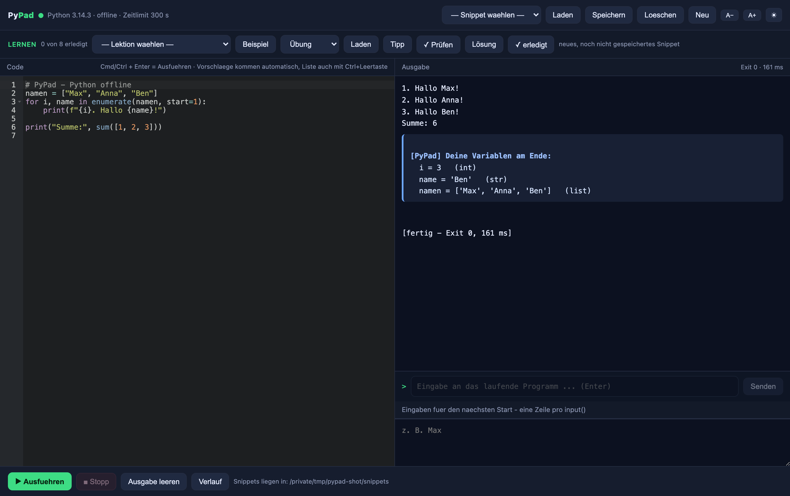

# PyPad

Ein Python-Editor im Browser — **zwei Betriebsarten, eine Oberfläche**:

- **Lokal (Standard):** läuft auf dem eigenen Rechner, die Oberfläche ist eine Webseite auf `127.0.0.1`,
  ausgeführt wird dein Code mit dem installierten Python. Kein Konto, keine Cloud.
- **Server (optional):** `pypad-server.py` + `online.html` — Login, eigener Workspace pro Benutzer,
  ausgeführt wird der Code in einem **abgesicherten Sandkasten** (eigener Systembenutzer, Speicher-/
  CPU-Limits, standardmäßig ohne Netz; auf Wunsch mit Internet). Für Handy, Tablet und andere Rechner
  im eigenen Netz oder Tailnet.

*A browser-based Python editor in two modes: local (127.0.0.1, your own Python) and an optional server
variant with login, per-user workspaces and a sandboxed runner.*



## Was drin ist

- **Editor (Ace)** mit Python-Syntaxhervorhebung, Zeilennummern und **Autovervollständigung**
  (Python-Schlüsselwörter, Builtins, Modulnamen deiner Installation; bei `os.` / `math.` auch die
  echten Attribute — nur für Module, die der Code selbst importiert)
- **Ausführen** per Klick oder **Cmd+Enter**: Ausgabe und Fehler getrennt, Exit-Code und Laufzeit
- **Echte Live-Eingabe:** `input()` funktioniert wie im Terminal — unten tippen, Enter
- **■ Stopp** beendet laufende Programme (auch Endlosschleifen; Kindprozesse werden mitbeendet),
  Standard-Zeitlimit 300 s
- **Fehler springen ins Auge:** läuft etwas schief, wird die betroffene Zeile im Editor **rot
  hervorgehoben** (blinkt kurz auf), im Rand erscheint ein Fehlersymbol mit der Meldung und der
  Cursor springt genau dorthin. In der Statuszeile steht „Fehler in Zeile N" — anklicken springt zurück.
- **Die Stelle wird punktgenau gezeigt** (nicht nur die Zeile): im Editor wird genau das
  fehlerhafte Stück eingefärbt (z. B. `10 / x`), der Cursor steht darauf, und im Erklärungs-Kasten
  steht die Codezeile mit Zeiger:
  ```text
    print(10 / x)
          ~~~^~~  <-- hier ist der Fehler
  ```
- **Fehler werden erklärt:** unter der Ausgabe steht ein Kasten mit **Klartext**: um welchen Fehler
  es geht, **warum** er passiert ist und **was man dagegen tun kann** — plus Tipps wie
  „Meintest du 'name'?" oder „Meintest du .upper?". Abgedeckt sind u. a. SyntaxError,
  IndentationError, NameError, TypeError, ValueError, ZeroDivisionError, IndexError, KeyError,
  AttributeError, ModuleNotFoundError, FileNotFoundError, EOFError, UnboundLocalError, RecursionError.
- **Hinweise im Code:** typische Stolpersteine werden schon **vor** dem Lauf markiert —
  unbenutzter Import, Zuweisung ohne Verwendung, `except:` ohne Typ, Vergleich mit `== None`,
  Name **nirgends definiert** (Tippfehler), Nutzung **vor** der Zuweisung und
  „Funktion gibt nichts zurück (None), Ergebnis wird trotzdem benutzt".
  Gelbe Zeilenmarkierung, Symbol im Rand, Liste in der Ausgabe mit **anklickbaren Zeilennummern**,
  dazu ein Knopf **„→ Zeile N"** in der Ausgabe, der zur Fehler-/Hinweiszeile springt.
- **Übungen mit Selbstkontrolle:** der Knopf **✓ Prüfen** testet deinen Code automatisch gegen
  mehrere Fälle (mit vorgegebenen Eingaben) und zeigt ✅/❌ samt „erwartet/bekommen". Bestehst du alle,
  wird die Lektion als **erledigt** markiert (Anzeige „3 von 8 erledigt").
- **Drei Schwierigkeitsstufen** pro Lektion: **Übung**, **Übung +**, **Übung ++**
- **Tipp-Knopf**: schrittweise Denkanstöße, ohne die Lösung zu verraten
- **Variablen am Ende** eines Laufs werden angezeigt (Name, Wert, Typ) — erklärt die meisten Fragen
- **Verlauf**: die letzten 12 Läufe mit Ergebnis; ein Klick holt den Code zurück
- **Schritt-für-Schritt-Debugger** (🐞): Programm **Zeile für Zeile** ablaufen lassen — aktuelle Zeile
  im Editor markiert, die Variablen dazu sichtbar, „Weiter" läuft bis zum Ende, „Ende" bricht ab
- **Vorlagen** in der Autovervollständigung (`for`, `def`, `try`, `with` … als Gerüst)
- **Auto-Speichern** von Übungen und Snippets, **Cmd+S** speichert sofort
- **Darstellung umschaltbar**: hell/dunkel und Schriftgröße (wird gemerkt)
- **Einstellungen** (⚙): Lernen-Leiste, Hinweise, Variablen-Anzeige, Fehler-Erklärung,
  Auto-Speichern und Zeilennummern ein-/ausblenden; Schriftgröße per Regler
- **Als Code-Editor:** Datei-Browser (beliebigen Ordner öffnen, .py-Dateien auflisten,
  öffnen, bearbeiten und auf der Platte speichern) plus Tabs für mehrere offene Dateien
- **Code-Faltung**, Zeile:Spalte-Anzeige, ungespeichert-Punkt, Ausgaben-Deckel bei sehr langen Läufen
- **Git-Anbindung:** Status, Diff, Commit, Push und Pull direkt in der Seitenleiste (funktioniert mit jedem Git-Ordner)
- **Lernbereich mit Erklärungen (LERNEN):** acht Lektionen von Ausgaben bis Mini-Projekten — je mit Beispiel, Übung, Lösung, Tipp und Quiz, plus Knopf „Erklärung" (Ziel, Erklärung, Beispielcode)
- **HTML-Live-Vorschau:** bei HTML-Dateien zeigt das Auge im Ausgabe-Bereich die gerenderte Seite neben dem Editor — sie aktualisiert sich live beim Tippen (abgeschotteter iframe, Skripte laufen, aber ohne Zugriff auf PyPad)
- **Löschen:** **✕** in der Dateiliste (Datei und Ordner) und ein **Papierkorb-Knopf** in der Editor-Leiste für die gerade offene Datei — auch für Lektions- und Snippet-Dateien. Gelöschte Dateien verschwinden dabei auch aus der Liste "Zuletzt geöffnet" und aus offenen Registerkarten. **Lektionsordner und Lektionsmaterial** (Beispiel, Lösung, Info, Plan) sind geschützt — löschbar sind dort nur deine eigenen Dateien
- **GitHub-Anmeldung:** Token im Git-Panel eintragen (wird bei GitHub geprüft, danach gehen **Push**, **Pull** und **private Repos**). Online wird er pro Benutzer mit `chmod 600` gespeichert, offline nur lokal im Browser; „Abmelden" entfernt ihn wieder.
- **Internet im ausgefuehrten Code:** `urllib`/`requests` funktionieren direkt; fehlt dem Python ein Zertifikatsbuendel, reicht PyPad `SSL_CERT_FILE`/`REQUESTS_CA_BUNDLE` automatisch nach (macOS-Symptom `CERTIFICATE_VERIFY_FAILED`)
- **Code von GitHub laden:** im Git-Panel eine GitHub-Adresse eintippen (`https://github.com/user/repo` oder kurz `user/repo`) und **Laden** — das Repo wird in den Ordner geklont. Danach zeigen Status/Commit/Push/Pull auf das geladene Repo. Nur `github.com` wird angenommen, geklont wird flach (`--depth 1`).
- **Mehrere Sprachen:** Syntax-Highlighting für JavaScript, HTML, CSS, JSON und Markdown (Ausführen bleibt Python)
- **Markdown-Vorschau**, **Gehe-zu-Definition** (F3), **zuletzt geöffnete Dateien** und **frei verschiebbare Fenstergrößen** (Trenner ziehen)
- **Server-Zugriff (SSH):** Dateien auf entfernten Rechnern über SSH auflisten, öffnen und speichern — Server einfach ins „Server"-Feld der Datei-Leiste eintippen
- **Snippets** speichern / laden / löschen
- **Lernbereich:** Lektionen mit *Beispiel / Übung / Lösung*; Wechseln verliert keine Eingaben,
  Übungen werden automatisch gesichert
- **Selbsttest** mit 65 Prüfungen (`selbsttest.py`)

## Voraussetzungen

- Python 3 (getestet mit 3.14) — Prüfen: `python3 --version`
- Sonst nichts: keine externen Bibliotheken, kein Build-Schritt, keine Installation
- Läuft auf **macOS** (getestet), **Linux** (`./PyPad.sh`) und **Windows** (`PyPad.bat`)

## Start

```bash
git clone https://github.com/Xonni-star/pypad.git
cd pypad
./PyPad.command          # macOS: Doppelklick im Finder
./PyPad.sh               # Linux
PyPad.bat                # Windows
# oder einfach:  python3 pypad.py
```

Der Browser öffnet sich automatisch auf `http://127.0.0.1:8765/`.
Terminal-Fenster offen lassen; beenden mit Ctrl+C.

## Verbindungen (SSH / FTP / FTPS)

Die Datei-Leiste hat ein Verbindungs-Auswahlfeld plus ein Zahnrad. Damit legst du Verbindungen an:
Name, Protokoll (SSH, FTP, FTPS), Host, Port, Benutzer, Passwort.

- Auswahl einer Verbindung: Dateiliste, Oeffnen und Speichern (Cmd+S) gehen auf den Server.
- SSH nutzt deinen Key-Login (SSH mit Passwort braucht zusaetzlich das Tool sshpass).
- FTP/FTPS laufen nativ (ftplib), inklusive Passwort-Login.
- Zugangsdaten liegen lokal in verbindungen.json (nur fuer dich lesbar, chmod 600).
- Pfade werden sauber quotiert - kein Shell-Injection.

Die Datei-Leiste hat ein **Server**-Feld. Steht dort ein Server-Name (Alias aus deiner
`~/.ssh/config` oder eine IP), gehen Liste/Lesen/Speichern über **SSH** statt lokal:

- Der Rechner muss per SSH erreichbar sein und **Key-Login** erlauben (kein Passwort-Prompt),
  z. B. Eintrag in `~/.ssh/config` mit `IdentityFile`.
- Befehle: `ls`, `cat`, `cat > pfad` — Pfade werden sauber quotiert, kein Shell-Injection.
- `Cmd+S` schreibt die Datei direkt auf den Server zurück.

## Online-Variante (PyPad Server)

Zusaetzlich gibt es eine abgesicherte Online-Variante fuer den Betrieb auf einem Server
(Datei pypad-server.py + online.html):

- Login + Benutzerverwaltung (Admin legt Benutzer an; Passwoerter scrypt-gehasht)
- Jeder Benutzer hat seinen eigenen Workspace
- Code laeuft abgesichert: eigener System-User, kein Netzwerk, Speicher-/CPU-Limits
- HTTPS mit echtem Zertifikat, Sitzungen (HttpOnly/Secure/SameSite), Login-Bremse
- Dateizugriff nur im eigenen Workspace (Pfad-Traversal blockiert)
- Gleiches Git-Panel wie offline: Repo von GitHub laden, danach Status/Diff/Commit/Push/Pull im geladenen Ordner
- **GitHub-Anmeldung** per Token (geprüft über die GitHub-API, serverseitig mit `chmod 600` je Benutzer) — damit funktionieren Push, Pull und private Repos
- **Löschen** von Dateien und Ordnern direkt in der Liste (✕ mit Rückfrage); der Workspace selbst bleibt geschützt
- **Fenster einstellbar:** Trenner zwischen Seitenleiste, Editor und Ausgabe lassen sich ziehen (Breiten werden im Browser gemerkt); bei schmalem Fenster wird gestapelt
- **HTML-Live-Vorschau** wie offline; HTML/JavaScript/CSS/JSON werden nach Dateityp hervorgehoben
- Adressen werden **IPv4 zuerst** aufgeloest (vermeidet lange Haenger, wenn eine IPv6-Adresse vorhanden aber nicht erreichbar ist)
- Optionaler **Internet-Zugriff** pro Lauf (Haekchen "Internet", Standard aus): Internet ja, eigenes Netz nein - Loopback, RFC1918, Tailnet, Link-Local und IPv6-Privat bleiben gesperrt (nftables filtert nur den Sandkasten-Benutzer). Einrichtung: `/srv/pypad/netz-setup/setup.sh` als root.

## App und Startskripte

- **macOS:** `PyPad.command` (Terminal) oder die beiliegende App-Hülle `PyPad.app` fürs Dock.
  Hinweis: macOS schützt den Schreibtisch (TCC) — darf die App dort nicht lesen, startet sie PyPad
  automatisch über das Terminal.
- **Linux:** `./PyPad.sh`
- **Windows:** `PyPad.bat`

## Selbsttest

```bash
python3 selbsttest.py     # PyPad muss dabei laufen
```

## Optionen (Umgebungsvariablen)

| Variable | Standard | Bedeutung |
|---|---|---|
| `PYPAD_PORT` | 8765 | Port des lokalen Servers |
| `PYPAD_MAX_RUNTIME` | 300 | Zeitlimit pro Lauf in Sekunden |
| `PYPAD_TIMEOUT` | 20 | Zeitlimit nur für den einfachen `/run`-Endpunkt |
| `PYPAD_NO_BROWSER` | — | `1` = Browser nicht automatisch öffnen |

## Endpunkte (lokal)

| Methode | Pfad | Zweck |
|---|---|---|
| GET | `/` | Oberfläche |
| GET | `/info` | Python-Version, Pfade, Zeitlimit |
| GET | `/lektionen` | Liste der Lektionen |
| GET | `/files?dir=`, `/file?dir=&name=` | Datei listen / lesen |
| POST | `/file`, `/delete` | Datei speichern / löschen |
| POST | `/complete` | Vervollständigungsvorschläge |
| POST | `/run/start`, `/run/poll`, `/run/input`, `/run/stop` | Programm starten, Ausgabe streamen, Eingabe, Stopp |
| POST | `/run` | starten + auf Ende warten (einfach, für Skripte) |

## Sicherheit

- Der Server hört **nur auf 127.0.0.1** — von außen nicht erreichbar.
- Dateizugriff ausschließlich in `snippets/` und `lektionen/<lektion>/`;
  Pfad-Traversal, absolute Pfade und Punkt-Dateien werden abgewiesen.
- Programme laufen als dein Benutzer in einer eigenen Prozessgruppe.

## Eigene Lektionen

Es liegen acht Lektionen bei (`lektionen/lektion-01-...` bis `-08-...`) — jeweils mit
`beispiel.py`, `uebung.py` und `LOESUNG.py`, dazu ein `LERNPLAN.md`.
Eigene Lektionen einfach daneben anlegen und in `lektionen/lektionen.json` eintragen:
Eigene Lektionen einfach daneben anlegen und in `lektionen/lektionen.json` eintragen:

```text
lektionen/lektionen.json           # [{"nr": "01", "titel": "...", "dir": "lektion-01-..."}]
lektionen/lektion-01-.../beispiel.py
lektionen/lektion-01-.../uebung.py
lektionen/lektion-01-.../LOESUNG.py
```

## Lizenz

PyPad steht unter der **MIT-Lizenz** — vollständiger Text in [LICENSE](LICENSE).
Kurz: benutzen, verändern und weitergeben erlaubt, solange Copyright-Hinweis und Lizenztext
mitgeliefert werden. **Keine Gewährleistung** („as is"), Benutzung auf eigene Gefahr;
Haftung für Schäden oder Datenverlust ist ausgeschlossen.

**Fremdcode:** Der mitgelieferte Editor **Ace 1.44.0** (`vendor/`) steht unter der
**BSD-3-Clause-Lizenz**, © 2010 Ajax.org B.V. Der vollständige Lizenztext, die Dateiliste und die
Prüfsummen stehen in [THIRD-PARTY.md](THIRD-PARTY.md). Darüber hinaus wird **kein** Fremdcode
verwendet — PyPad nutzt ausschließlich die Python-Standardbibliothek.

**Sicherheit & Haftung:** PyPad führt Python-Code lokal auf dem eigenen Rechner aus und lauscht
nur auf 127.0.0.1. Führe damit keinen Code aus, dem du nicht vertraust, und sichere eigene
Daten — für Datenverlust wird nicht gehaftet (siehe MIT-Lizenz).

**Datenschutz:** PyPad selbst baut **keine Verbindungen ins Internet** auf — keine Telemetrie,
keine Konten, keine externen Dienste, keine Cookies. Alle Dateien (Code, Einstellungen) bleiben
lokal. (Der Code, den *du* ausführst, kann natürlich selbst Netzwerk nutzen — das liegt in deiner Hand.)
